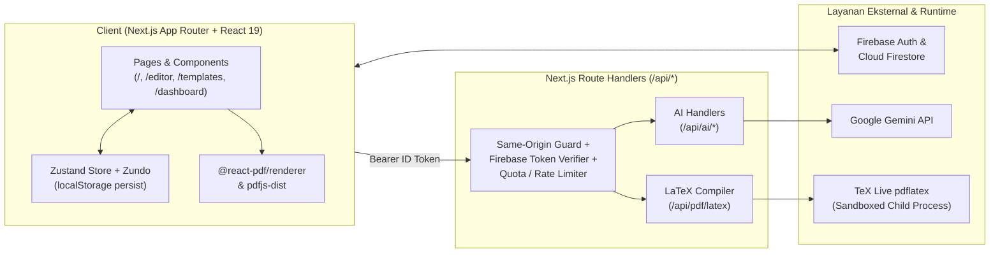

# Craftfolio — ATS-Friendly CV Builder

> **"Kualitas tipografi sekelas LaTeX, semudah mengisi Google Form."**

**Craftfolio** adalah aplikasi web pembuat CV berbasis *split-screen editor* yang memungkinkan siapa saja menyusun resume bersih, terstruktur satu kolom, dan ramah *Applicant Tracking System* (ATS) tanpa perlu menulis kode LaTeX atau mengatur margin dan tipografi secara manual.

> **Catatan ATS:** Kompatibilitas ATS tidak memiliki standar tunggal. Craftfolio berfokus pada struktur dokumen konvensional satu kolom, urutan baca linear, dan teks PDF yang dapat diseleksi (*selectable vector text*), disertai pengecekan berbasis aturan—bukan mengklaim jaminan mutlak lolos semua sistem ATS.

---

## Daftar Isi

1. [Fitur Utama](#fitur-utama)
2. [Tech Stack](#tech-stack)
3. [Arsitektur & Struktur Proyek](#arsitektur--struktur-proyek)
4. [Skema Database & Model Data](#skema-database--model-data)
5. [Dokumentasi API](#dokumentasi-api)
6. [Cara Setup & Menjalankan](#cara-setup--menjalankan)
7. [Perintah Verifikasi & Testing](#perintah-verifikasi--testing)
8. [Referensi Dokumentasi Internal](#referensi-dokumentasi-internal)

---

## Fitur Utama

### 1. Workspace & Editor
- **Split-Screen Live Editor (`/editor`):** Form pengisian terpandu di panel kiri dan pratinjau kertas (A4 / US Letter) *real-time* di panel kanan (otomatis menjadi tab **Edit** & **Preview** di mobile).
- **Multi-Document IDE Workspace:** Sidebar *File Tree* (shortcut `Ctrl/Cmd + B`) dan *Tab Bar* untuk mengelola, menduplikasi, mengganti nama, dan berpindah antar beberapa versi CV sekaligus.
- **Master Profile Controls:** Ubah urutan *section* via *drag-and-drop* (`@dnd-kit`) atau tombol naik/turun, serta nyalakan/matikan visibilitas *section*, item, maupun *bullet point* individual tanpa menghapus data.
- **Custom Sections & Multi-Bahasa:** Mendukung 9 *section* standar (*Summary, Experience, Education, Projects, Skills, Certifications, Awards, Volunteering, Languages*) plus *Custom Sections* tanpa batas nama kategori, dengan dukungan label bahasa Indonesia (`id`) dan Inggris (`en`).
- **Undo / Redo & Guest Mode:** Bekerja langsung tanpa login dengan penyimpanan otomatis di `localStorage`, riwayat *Undo/Redo* (`zundo`), serta *Export/Import* cadangan `.json`.

### 2. Template, Tipografi & Tema UI
- **4 Template ATS Terkurasi (`/templates`):** *Classic Academic* (gaya LaTeX / Jake's Resume), *Modern Minimalist*, *Compact*, dan *Executive Standard* — seluruhnya satu kolom.
- **Kustomisasi Tata Letak:** Pilihan ukuran kertas (`A4` / `LETTER`), kerapatan spasi (`compact` / `normal` / `relaxed`), target halaman (`1` / `2` halaman), dan tipografi (`Inter`, `Roboto`, `Computer Modern / Serif`, `Merriweather`).
- **Tema Warm Forest Sage & Dark Mode:** Antarmuka adaptif dengan dukungan *Light / Dark Mode* (`ColorSchemeToggle`) dan maskot interaktif **Foldy** (*adaptive coach*, indikator mood real-time, dan *milestone celebration toast*).

### 3. Analisis ATS & Ekspor Dokumen
- **ATS Readability Checker:** Linter deterministik berbasis aturan (`Good` / `Review` / `Fix`) untuk kelengkapan kontak, panjang ringkasan, kata kerja aktif, metrik terukur, dan jumlah halaman.
- **ATS X-Ray Mode:** Simulasi tampilan teks linear sebagaimana dibaca oleh parser teks ATS.
- **Job Description (JD) Keyword Matcher:** Analisis pencocokan kata kunci antara deskripsi lowongan kerja dan isi CV aktif secara lokal.
- **Dual PDF Export Engine + Source LaTeX:**
  - **Server-side LaTeX (`pdflatex`):** Kompilasi `.tex` menjadi PDF autentik sekelas Overleaf melalui `/api/pdf/latex`.
  - **Client-side Fallback (`@react-pdf/renderer`):** Otomatis aktif jika `pdflatex` tidak tersedia, menghasilkan PDF vektor dengan 100% teks *selectable*.
  - **Ekspor `.tex`:** Unduh kode sumber LaTeX siap pakai untuk diedit lebih lanjut di Overleaf.

### 4. Asisten AI Gemini (Terproteksi Auth & Kuota)
- **AI Bullet-Point Enhancer:** Merapikan poin pencapaian ke pola *Action → Context → Result* lengkap dengan deteksi otomatis angka halusinasi (*invented metrics warning*).
- **AI Professional Summary:** Memoles ringkasan yang sudah ada (`polish`) atau membuat draf otomatis dari seluruh isi CV (`generate`).
- **Import CV Otomatis (PDF / DOCX / Teks):** Ekstraksi teks di sisi klien (`pdfjs-dist` untuk PDF & parser XML untuk DOCX) lalu dipetakan oleh Gemini menjadi struktur `ResumeDocument` siap edit.

### 5. Autentikasi & Cloud Sync
- **Firebase Authentication:** Login/Register menggunakan Google OAuth atau Email & Password.
- **Cloud Firestore Sync & Dashboard (`/dashboard`):** Sinkronisasi otomatis lintas perangkat dengan penggabungan cerdas (*smart merge*) antara draf lokal dan cloud, serta halaman dashboard manajemen koleksi CV.

---

## Tech Stack

| Kategori | Teknologi | Versi / Keterangan |
| :--- | :--- | :--- |
| **Framework** | Next.js (App Router, Turbopack) | `16.4.6` (`output: "standalone"`, `cacheComponents`, `partialPrefetching`) |
| **Bahasa & UI** | React, TypeScript | React `19.3.0`, TypeScript `^5` |
| **Styling** | Tailwind CSS + `@tailwindcss/turbopack` | `4.3.3` |
| **State & History** | Zustand + Zundo (`temporal`) | Zustand `^5.1.0`, Zundo `^2.3.0` |
| **Form & Validasi** | Zod, React Hook Form | Zod `^4.6.7`, RHF `^7.92.0` |
| **Drag & Drop** | `@dnd-kit/core`, `@dnd-kit/sortable` | `^6.3.1` / `^10.0.0` |
| **Ikon** | `lucide-react` | `^1.77.0` |
| **PDF & Parsing** | `@react-pdf/renderer`, `pdfjs-dist`, TeX Live (`pdflatex`) | Client vector PDF, PDF text extractor, & Server LaTeX engine |
| **AI SDK & Model** | Vercel AI SDK (`ai`), `@ai-sdk/google` | Gemini API (`gemini-flash-lite-latest` default, override via `GEMINI_MODEL`) |
| **Auth & Database** | Firebase Auth & Cloud Firestore | Firebase Web SDK `^13.4.0` + `firestore.rules` |
| **Testing & Lint** | Vitest, ESLint | Vitest `^4.1.12`, ESLint `^9` (`eslint-config-next`) |
| **Containerization** | Docker & Docker Compose | Multi-stage build dengan TeX Live (`node:20-bookworm-slim`) |

---

## Arsitektur & Struktur Proyek

### Gambaran Arsitektur



### Lapisan Utama
1. **Pages & UI (`src/app`, `src/components`):** Halaman Landing (`/`), Split-Screen Editor (`/editor`), Template Gallery (`/templates`), dan Cloud Dashboard (`/dashboard`).
2. **State Management (`src/store`):** Dibagi menjadi 3 slice utama — `document-slice.ts` (CRUD dokumen, tab, file order), `section-slice.ts` (edit konten, drag-and-drop, visibilitas), dan `ui-slice.ts` (auth state, cloud sync status, AI quota snapshot, modal state).
3. **Domain & Security (`src/lib`):** Skema Zod (`schemas/resume.ts`), ATS linter, JD matcher, generator & compiler LaTeX, guard keamanan (`request-guard.ts`, `auth-guard.ts`), dan limiter kuota AI (`quota.ts`).
4. **Security Headers (`next.config.ts`):** Menerapkan `Content-Security-Policy`, `X-Frame-Options: DENY`, `X-Content-Type-Options: nosniff`, `Referrer-Policy`, `Permissions-Policy`, dan `Strict-Transport-Security`.

### Struktur Direktori

```text
.
├── src/
│   ├── app/
│   │   ├── page.tsx                        # Landing page
│   │   ├── editor/page.tsx                 # Split-screen CV editor workspace
│   │   ├── templates/page.tsx              # Galeri & pratinjau template ATS
│   │   ├── dashboard/page.tsx              # Dashboard manajemen koleksi CV Cloud
│   │   ├── api/
│   │   │   ├── ai/
│   │   │   │   ├── enhance/route.ts        # POST — AI Bullet-Point Enhancer
│   │   │   │   ├── enhance-summary/route.ts# POST — AI Professional Summary
│   │   │   │   ├── parse-cv/route.ts       # POST — AI Structured CV Importer
│   │   │   │   └── usage/route.ts          # GET  — Cek kuota AI harian
│   │   │   └── pdf/
│   │   │       └── latex/route.ts          # POST — Kompilasi PDF via pdflatex
│   │   ├── layout.tsx                      # Root layout, Google Fonts, color scheme script
│   │   └── globals.css                     # Token warna Warm Forest Sage & Dark Mode
│   ├── components/
│   │   ├── auth/                           # AuthModal, CloudSyncManager, LandingAuthActions
│   │   ├── dashboard/                      # CvDocumentCard, DashboardStates
│   │   ├── editor/                         # EditorTopBar, FileTreeSidebar, WorkspaceTabBar,
│   │   │                                   # EditorPanel, BasicsForm, SummaryEditor, SectionForms,
│   │   │                                   # BulletListEditor, AtsCheckerModal, JdMatcherModal, CvImportModal
│   │   ├── landing/                        # HeroWorkspacePreview, WorkflowShowcase, TemplateStripSection, dll.
│   │   ├── mascot/                         # FoldyMascot, FoldyCoachPopover, FoldyCelebrationToast
│   │   ├── pdf/                            # PdfDocument (@react-pdf/renderer), PdfExportButton
│   │   └── preview/                        # PreviewPanel, ResumeHtmlRenderer, AtsXRayView
│   ├── lib/
│   │   ├── ai/                             # gemini.ts, auth-guard.ts, quota.ts, client-fetch.ts,
│   │   │                                   # bullet-enhancer.ts, summary-enhancer.ts, cv-importer.ts
│   │   ├── firebase/                       # config.ts, env.ts, auth.ts, firestore-client.ts, firestore-sync.ts
│   │   ├── schemas/resume.ts               # Skema Zod & RESUME_LIMITS (Single Source of Truth)
│   │   ├── security/request-guard.ts       # Same-origin CSRF guard & sliding-window rate limiter
│   │   ├── __tests__/                      # 17 suite unit test Vitest (151+ test case)
│   │   ├── ats-linter.ts                   # Engine pengecekan ATS deterministik
│   │   ├── jd-matcher.ts                   # Engine pencocokan keyword Job Description
│   │   ├── latex-generator.ts              # Konversi ResumeDocument -> source LaTeX (.tex)
│   │   ├── latex-compiler.ts               # Eksekusi sandboxed pdflatex + queue concurrency
│   │   ├── pdf-text-extractor.ts           # Ekstraktor teks PDF (pdfjs-dist)
│   │   ├── cv-file-extractor.ts            # Ekstraktor teks file PDF & DOCX
│   │   ├── foldy-coach.ts                  # State machine mood & skor kesiapan ATS untuk Foldy
│   │   └── template-tokens.ts              # Token dimensi kertas, font, & kerapatan
│   └── store/
│       ├── use-resume-store.ts             # Store utama Zustand + persist + zundo
│       ├── types.ts                        # Tipe state & action store
│       └── slices/                         # document-slice.ts, section-slice.ts, ui-slice.ts
├── firestore.rules                         # Security Rules & validasi skema Cloud Firestore
├── firestore.indexes.json                  # Konfigurasi index Firestore
├── firebase.json                           # Konfigurasi Firebase CLI
├── Dockerfile                              # Multi-stage production build + TeX Live
├── Dockerfile.dev                          # Container development
├── docker-compose.yml                      # Orchestration profil dev & prod
├── next.config.ts                          # Konfigurasi Next.js, Turbopack, & Security Headers
└── agents-md/                              # PRD, DESIGN, brand-guideline, SETUP, GIT_RULES
```

---

## Skema Database & Model Data

Craftfolio menggunakan **Cloud Firestore** sebagai database cloud (untuk pengguna yang login) dan `localStorage` sebagai penyimpanan lokal (*Guest Mode*). Seluruh akses Firestore dijaga oleh [`firestore.rules`](./firestore.rules) dengan isolasi ketat berbasis kepemilikan (`request.auth.uid == userId`), proteksi *immutable fields*, dan validasi skema pada setiap operasi `create` maupun `update`.

### 1. Hierarki Koleksi Cloud Firestore

```text
users/{userId}                                       # Metadata workspace pengguna
└── resumes/{resumeId}                               # Dokumen CV lengkap (ResumeDocument)
    └── versions/{versionId}                         # Snapshot versi dokumen (immutable)
```

#### Koleksi `users/{userId}`
| Field | Tipe | Aturan / Keterangan |
| :--- | :--- | :--- |
| `uid` | `string` | Wajib, *immutable*, harus sama dengan `userId` (`request.auth.uid`) |
| `email` | `string \| null` | Opsional, maksimal 254 karakter, format email valid |
| `displayName` | `string \| null` | Opsional, maksimal 120 karakter |
| `activeDocumentId` | `string` | Wajib, maksimal 128 karakter — ID CV yang sedang aktif |
| `openTabIds` | `string[]` | Wajib, maksimal 100 item — urutan tab editor yang terbuka |
| `fileOrder` | `string[]` | Wajib, maksimal 200 item — urutan file di sidebar |
| `updatedAt` | `string` | Wajib, format ISO 8601 (maksimal 64 karakter) |

#### Subkoleksi `users/{userId}/resumes/{resumeId}`
Menyimpan objek `ResumeDocument` yang tervalidasi oleh Zod (`src/lib/schemas/resume.ts`) dan `firestore.rules`:

| Field | Tipe | Aturan / Keterangan |
| :--- | :--- | :--- |
| `id` | `string` | Wajib, *immutable*, harus sama dengan `resumeId` (1–128 karakter) |
| `schemaVersion` | `number` | Wajib, integer `1..100` (default `1`) |
| `userId` | `string` | Wajib, *immutable*, harus sama dengan `userId` |
| `title` | `string` | Wajib, judul dokumen CV (maksimal 200 karakter di Firestore / 300 di Zod) |
| `targetRole` | `string?` | Opsional, target posisi pekerjaan |
| `language` | `"id" \| "en"` | Wajib, bahasa label *section* dokumen |
| `createdAt` | `string` | Wajib, timestamp ISO 8601 |
| `updatedAt` | `string` | Wajib, timestamp ISO 8601 |
| `config` | `object` | Konfigurasi layout: `templateId`, `paperSize`, `density`, `fontFamily`, `targetPages`, `sectionOrder` |
| `basics` | `object` | Identitas & ringkasan: `fullName`, `headline?`, `email`, `phone?`, `location?`, `links[]`, `summary: { text, isVisible }` |
| `sections` | `object` | Kumpulan section: `experience`, `education`, `projects`, `skills`, `certifications`, `awards`, `volunteering`, `languages`, `customSections[]` |

#### Subkoleksi `users/{userId}/resumes/{resumeId}/versions/{versionId}`
| Field | Tipe | Aturan / Keterangan |
| :--- | :--- | :--- |
| `id` | `string` | Wajib, *immutable*, sama dengan `versionId` |
| `resumeId` | `string` | Wajib, *immutable*, sama dengan `resumeId` |
| `userId` | `string` | Wajib, *immutable*, sama dengan `userId` |
| `createdAt` | `timestamp \| string` | Wajib, *immutable* |
| `label` | `string?` | Opsional, catatan/label versi (maksimal 200 karakter) |
| `snapshot` | `ResumeDocument` | Wajib, *immutable*, salinan utuh `ResumeDocument` |

### 2. Ringkasan Batas Skema (`RESUME_LIMITS`)
Didefinisikan di [`src/lib/schemas/resume.ts`](./src/lib/schemas/resume.ts):
- `MAX_LINKS`: 20 tautan
- `MAX_BULLETS_PER_ITEM`: 30 poin per item
- `MAX_ITEMS_PER_SECTION`: 50 item per *section*
- `MAX_CUSTOM_SECTIONS`: 20 *custom sections*
- `MAX_SECTION_ORDER`: 30 kunci urutan *section*
- `MAX_SUMMARY_LEN`: 8.000 karakter | `MAX_LONG_TEXT_LEN`: 2.000 karakter

---

## Dokumentasi API

Semua endpoint berada di bawah `/api/*` (Next.js App Router Route Handlers).

### Keamanan & Batasan Umum
- **Same-Origin Check:** Seluruh endpoint `POST` memvalidasi header `Origin`/`Referer` agar berasal dari origin yang sama (`verifySameOriginRequest`).
- **Autentikasi Endpoint AI (`/api/ai/*`):** Wajib menyertakan header `Authorization: Bearer <FIREBASE_ID_TOKEN>`. Token diverifikasi di server melalui Google Identity Toolkit (`accounts:lookup`) dengan cache in-memory ber-TTL maksimal 3 menit.
- **Sistem Kuota AI Harian (Reset 00:00 WIB):**
  - Default batas per pengguna: **10x/hari** untuk fitur `enhance` (bullet + summary) dan **2x/hari** untuk `import` (parse CV).
  - Default *burst limit*: **4 permintaan/menit** per pengguna.
  - Default *global circuit breaker*: **450 permintaan/hari** & **12 RPM** untuk melindungi API key free-tier.
  - Kuota otomatis di-*refund* jika pemanggilan upstream Gemini gagal/timeout.

---

### 1. `GET /api/ai/usage`
Mengambil status sisa kuota AI harian untuk pengguna yang sedang login.

- **Auth:** `Authorization: Bearer <FIREBASE_ID_TOKEN>`
- **Rate Limit:** 30 permintaan / menit per IP.
- **Response `200 OK`:**
```json
{
  "quota": {
    "enhance": { "used": 2, "limit": 10, "remaining": 8 },
    "import": { "used": 0, "limit": 2, "remaining": 2 },
    "resetAt": "2026-11-28T17:00:00.000Z"
  }
}
```
- **Error:** `401` (`AI_AUTH_REQUIRED`, `AI_AUTH_INVALID`), `429` (`RATE_LIMITED`), `502` (`AI_AUTH_VERIFY_FAILED`), `503` (`AUTH_UNAVAILABLE`).

---

### 2. `POST /api/ai/enhance`
Memperbaiki satu *bullet point* CV ke struktur *Action → Context → Result* tanpa mengarang angka/fakta baru.

- **Auth:** `Authorization: Bearer <FIREBASE_ID_TOKEN>`
- **Batas Payload:** 16 KB | **Bucket Kuota:** `enhance`
- **Request Body:**
```json
{
  "bulletText": "Membuat dashboard admin menggunakan React dan mempercepat loading halaman",
  "language": "id",
  "tone": "impact",
  "roleContext": {
    "companyOrProject": "PT Contoh Teknologi",
    "roleOrPosition": "Frontend Engineer",
    "sectionKey": "experience"
  }
}
```
  - `bulletText` *(string, wajib)*: 3–1.000 karakter.
  - `language` *(`"id" | "en"`, opsional, default `"en"`)*
  - `tone` *(`"concise" | "impact"`, opsional, default `"impact"`)*
- **Response `200 OK`:**
```json
{
  "improvedText": "Mengembangkan dashboard admin berbasis React yang mengoptimalkan waktu muat halaman bagi tim operasional.",
  "reasoning": "Menggunakan kata kerja aktif yang lebih kuat serta memperjelas konteks hasil tanpa menambah metrik fiktif.",
  "missingMetricsHint": "Pertimbangkan menambahkan angka nyata (mis. penurunan waktu muat dalam persen/detik) jika tersedia.",
  "inventedMetricsDetected": [],
  "aiGenerated": true,
  "quota": {
    "enhance": { "used": 3, "limit": 10, "remaining": 7 },
    "import": { "used": 0, "limit": 2, "remaining": 2 },
    "resetAt": "2026-11-28T17:00:00.000Z"
  }
}
```
- **Error:** `400` (`INVALID_BODY`, `INVALID_JSON`, `VALIDATION_ERROR`), `401`, `403` (origin mismatch), `413` (`PAYLOAD_TOO_LARGE`), `429` (`AI_QUOTA_EXCEEDED`, `AI_BURST_LIMITED`, `AI_SERVER_QUOTA_EXCEEDED`, `AI_RATE_LIMITED`), `503` (`AI_UNAVAILABLE`), `504` (`AI_TIMEOUT`).

---

### 3. `POST /api/ai/enhance-summary`
Memoles ringkasan profil yang sudah ada (`mode: "polish"`) atau membuat draf ringkasan baru berdasarkan fakta di CV (`mode: "generate"`).

- **Auth:** `Authorization: Bearer <FIREBASE_ID_TOKEN>`
- **Batas Payload:** 32 KB | **Bucket Kuota:** `enhance`
- **Request Body:**
```json
{
  "mode": "generate",
  "summaryText": "",
  "language": "en",
  "cvContext": {
    "headline": "Full-Stack Software Engineer",
    "targetRole": "Backend Engineer",
    "experience": [
      {
        "company": "Acme Corp",
        "position": "Software Engineer",
        "startDate": "2023",
        "endDate": "Present",
        "bullets": ["Built REST APIs serving 50k monthly users"]
      }
    ],
    "education": [
      { "institution": "Universitas Contoh", "degree": "S.Kom", "gpa": "3.85" }
    ],
    "projects": [
      { "name": "Craftfolio", "techStack": "Next.js, TypeScript, Firebase" }
    ],
    "skills": [
      { "category": "Backend", "skills": "Node.js, PostgreSQL, Docker" }
    ]
  }
}
```
- **Response `200 OK`:**
```json
{
  "improvedSummary": "Full-Stack Software Engineer experienced in designing scalable REST APIs serving 50k monthly users...",
  "reasoning": "Menyusun ringkasan 2–3 kalimat padat tanpa kata ganti orang pertama berdasarkan fakta CV.",
  "missingMetricsHint": null,
  "inventedMetricsDetected": [],
  "aiGenerated": true,
  "quota": { "...": "..." }
}
```
- **Error:** Sama dengan `/api/ai/enhance` (`400`, `401`, `403`, `413`, `429`, `503`, `504`).

---

### 4. `POST /api/ai/parse-cv`
Memetakan teks mentah hasil ekstraksi PDF/DOCX/tempel teks menjadi objek `ResumeDocument` yang valid secara skema, beserta daftar peringatan peninjauan (*warnings*).

- **Auth:** `Authorization: Bearer <FIREBASE_ID_TOKEN>`
- **Batas Payload:** 128 KB | **Bucket Kuota:** `import`
- **Request Body:**
```json
{
  "rawText": "ARYA GOBERTO\nSoftware Engineer | arya@example.com ...\n(min 30, maks 40.000 karakter)",
  "preferredLanguage": "id"
}
```
- **Response `200 OK`:**
```json
{
  "document": {
    "id": "resume-...",
    "schemaVersion": 1,
    "title": "CV Arya Goberto",
    "language": "id",
    "config": { "...": "..." },
    "basics": { "...": "..." },
    "sections": { "...": "..." }
  },
  "warnings": [
    "Periksa kembali tanggal pendidikan dan tautan profil sebelum menyimpan."
  ],
  "aiGenerated": true,
  "quota": { "...": "..." }
}
```
- **Error:** Sama dengan `/api/ai/enhance` (`400`, `401`, `403`, `413`, `429`, `503`, `504`).

---

### 5. `POST /api/pdf/latex`
Mengonversi JSON `ResumeDocument` menjadi source LaTeX (`.tex`) lalu mengompilasinya menggunakan `pdflatex` di direktori temporer terisolasi (`-no-shell-escape`, paranoid Web2C I/O `openin_any=p` / `openout_any=p`, environment ter-sanitasi tanpa membocorkan secret aplikasi).

- **Auth:** Publik (tetap dilindungi Same-Origin Check & IP Rate Limiter).
- **Batas Payload:** 512 KB | **Timeout:** 15 detik
- **Rate Limit & Concurrency:** Default 10 req/menit per IP, maksimal 2 kompilasi paralel dan antrean 6 request.
- **Request Body:** Objek utuh `ResumeDocument` sesuai [`ResumeDocumentSchema`](./src/lib/schemas/resume.ts).
- **Response `200 OK`:**
  - `Content-Type: application/pdf`
  - `Cache-Control: no-store`
  - `X-Pdf-Engine: pdflatex`
  - Body: Binary PDF buffer.
- **Error:**
  - `400` (`INVALID_BODY`, `INVALID_JSON`, `VALIDATION_ERROR`)
  - `403` (origin mismatch)
  - `413` (`PAYLOAD_TOO_LARGE`)
  - `429` (`LATEX_RATE_LIMITED` + header `Retry-After`)
  - `500` (`LATEX_COMPILATION_FAILED`)
  - `503` (`LATEX_COMPILER_UNAVAILABLE` jika `pdflatex` belum terpasang — client otomatis fallback ke `@react-pdf/renderer`, atau `LATEX_COMPILER_BUSY` jika antrean penuh).

---

## Cara Setup & Menjalankan

### Prasyarat
- **Node.js** v20+ & `npm` (untuk menjalankan secara lokal), **atau**
- **Docker & Docker Compose** v2 (sudah termasuk TeX Live / `pdflatex` pada build production).
- *(Opsional)* **TeX Live / MacTeX** secara lokal jika ingin menguji endpoint `/api/pdf/latex` tanpa Docker.
- *(Opsional)* Proyek **Firebase** (Authentication + Cloud Firestore) & **Google Gemini API Key** untuk mengaktifkan fitur Cloud Sync dan Asisten AI. *(Mode Guest, Editor, ATS Checker, dan Ekspor PDF client-side tetap berjalan normal tanpa API key).*

### 1. Konfigurasi Environment Variables

Salin `.env.example` menjadi `.env.local`:

```bash
cp .env.example .env.local
```

Daftar variabel lingkungan yang didukung:

| Variabel | Wajib? | Default | Keterangan |
| :--- | :---: | :--- | :--- |
| `NEXT_PUBLIC_FIREBASE_API_KEY` | Opsional* | — | Firebase Web API Key (*wajib untuk Auth, Cloud Sync, & verifikasi token AI*) |
| `NEXT_PUBLIC_FIREBASE_AUTH_DOMAIN` | Opsional* | — | Firebase Auth Domain |
| `NEXT_PUBLIC_FIREBASE_PROJECT_ID` | Opsional* | — | Firebase Project ID |
| `NEXT_PUBLIC_FIREBASE_STORAGE_BUCKET` | Opsional* | — | Firebase Storage Bucket |
| `NEXT_PUBLIC_FIREBASE_MESSAGING_SENDER_ID` | Opsional* | — | Firebase Messaging Sender ID |
| `NEXT_PUBLIC_FIREBASE_APP_ID` | Opsional* | — | Firebase App ID |
| `GOOGLE_GENERATIVE_AI_API_KEY` | Opsional* | — | API Key dari [Google AI Studio](https://aistudio.google.com/apikey) untuk fitur AI |
| `GEMINI_MODEL` | Opsional | `gemini-flash-lite-latest` | Override model Gemini yang digunakan |
| `AI_DAILY_ENHANCE_LIMIT` | Opsional | `10` | Kuota harian fitur enhance (bullet + summary) per user |
| `AI_DAILY_IMPORT_LIMIT` | Opsional | `2` | Kuota harian fitur import CV AI per user |
| `AI_BURST_PER_MINUTE` | Opsional | `4` | Batas permintaan AI per menit per user |
| `AI_GLOBAL_DAILY_LIMIT` | Opsional | `450` | Batas harian global seluruh user (proteksi API key) |
| `AI_GLOBAL_RPM_LIMIT` | Opsional | `12` | Batas permintaan per menit global |
| `PDFLATEX_BIN` | Opsional | Auto-detect | Path manual binary `pdflatex` (mis. `/Library/TeX/texbin/pdflatex`) |
| `LATEX_RATE_LIMIT_PER_MINUTE` | Opsional | `10` | Batas request `/api/pdf/latex` per menit per IP |
| `LATEX_MAX_CONCURRENT` | Opsional | `2` | Jumlah maksimum proses `pdflatex` berjalan bersamaan |
| `LATEX_MAX_QUEUE` | Opsional | `6` | Panjang maksimum antrean kompilasi LaTeX |

### 2. Opsi A — Menjalankan Secara Lokal (Development)

```bash
# 1. Install dependensi
npm install

# 2. Jalankan server development (Turbopack)
npm run dev
```

Akses aplikasi di browser:
- Landing Page: `http://localhost:3000`
- Split-Screen Editor: `http://localhost:3000/editor`
- Galeri Template: `http://localhost:3000/templates`
- Dashboard Cloud CV: `http://localhost:3000/dashboard`

### 3. Opsi B — Menjalankan dengan Docker

**Mode Development (dengan hot-reload):**
```bash
docker compose --profile dev up --build
```

**Mode Production (sudah menyertakan TeX Live untuk `/api/pdf/latex`):**
```bash
docker compose --profile prod up --build -d
```

**Menghentikan Container:**
```bash
docker compose --profile dev down
# atau
docker compose --profile prod down
```

### 4. Setup Cloud Firestore Rules (Jika Menggunakan Firebase)

Pastikan Firebase Authentication (Google & Email/Password) serta Cloud Firestore sudah aktif di Firebase Console, lalu deploy aturan keamanan dari proyek ini:

```bash
npx firebase-tools login
npx firebase-tools use <YOUR_FIREBASE_PROJECT_ID>
npx firebase-tools deploy --only firestore:rules,firestore:indexes
```

---

## Perintah Verifikasi & Testing

```bash
# Jalankan seluruh unit test (Vitest — 17 suite)
npm test

# Jalankan unit test dalam mode watch
npm run test:watch

# Cek tipe TypeScript
npx tsc --noEmit

# Cek ESLint
npm run lint

# Build production
npm run build
```

---

## Referensi Dokumentasi Internal

Dokumentasi spesifikasi dan panduan teknis tambahan tersimpan di root, `agents-md/`, dan `tasks/`:
- [CONTRIBUTING.md](./CONTRIBUTING.md) — Panduan kontribusi, alur Git, standar kode, & checklist PR
- [PRD.md](./agents-md/PRD.md) — *Product Requirements Document* & lingkup fitur
- [DESIGN.md](./agents-md/DESIGN.md) — *Technical Design Document* (arsitektur state, sinkronisasi PDF, aturan linter, & desain sistem)
- [brand-guideline.md](./agents-md/brand-guideline.md) — Sistem desain, palet warna *Warm Forest Sage*, *Dark Mode*, dan tipografi
- [SETUP.md](./agents-md/SETUP.md) — Panduan setup Next.js, Tailwind CSS, & Docker
- [GIT_RULES.md](./agents-md/GIT_RULES.md) — Aturan branching, format commit, & checklist push
- [AGENTS.md](./agents-md/AGENTS.md) — Panduan kerja untuk AI coding agent
- [todo.md](./tasks/todo.md) — Daftar tugas & roadmap eksekusi
